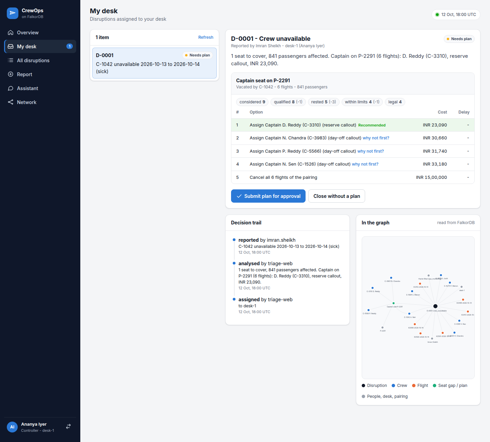

# CrewOps on FalkorDB

Crew-control agents for an airline operations room, with FalkorDB as the only data store.

When a crew member calls in sick, CrewOps finds the flights and passengers affected, lists the
crew who can legally cover the seat ranked by cost, sends the case to a controller's desk,
and needs a second person to approve the change before the roster is updated. Every answer
can show the Cypher queries it came from.

**Hackathon:** Graph Hacks: Context for AI Agents (WeMakeDevs × FalkorDB, 15–18 Oct 2026)
**Tracks:** Agents That Act on Connected Data (primary), Agent Memory and Coordination



## Features

- **Disruption analysis.** Sick crew, certificate lapses, flight delays, station closures and
  gate closures. Each one is analysed by traversing the graph and the results are written
  back as nodes and edges.
- **Legal cover, ranked by cost.** All seven duty rules are checked (duty period, 7-day and
  28-day limits, rest, rating, certificates, base). Crew who fail are listed with the rule
  they break.
- **Desk assignment.** Each analysed disruption goes to the controller desk with the fewest open
  disruptions (ties: fewest in total, then desk order), so work spreads evenly.
- **Four-eyes approval.** A controller picks an option for each seat (any legal crew member,
  holding the departure up to 4h for someone not yet free, operating one short, or cancelling,
  which asks for confirmation) and submits the plan. A
  different user approves it, and the roster change is committed in one Cypher query.
- **Delays.** A delay follows the aircraft rotation; legs that push a duty past its limit are
  proposed for cancellation, and crew the delay makes illegal become seats to re-crew.
- **Explanations.** Decision trail, "why not this crew member?", and a view of the
  disruption's subgraph.
- **Agents that coordinate through the graph.** Triage agents claim disruptions atomically
  (several can run in parallel), a notifier agent marks notices as delivered, and handoffs
  go to a desk's inbox.
- **Memory per user.** Each user has their own FalkorDB graph with sessions, questions,
  mentioned ids and preferences. Follow-ups like "is she legal for it?" work, and memory
  carries over to the next session.
- **Graph algorithms as tools.** PageRank and betweenness on the route network, weighted
  shortest paths for positioning crew, connected components.
- **Three interfaces.** Web console, CLI and MCP server. The assistant uses a language model
  (a free open model through Groq, or Claude) when a key is set, and a rule-based planner otherwise.

## Why FalkorDB is needed

There is no other database in the project. Everything above is a graph query:

| Feature | Graph work |
|---|---|
| Candidate pool | `Pairing → Aircraft → Airline ← Crew`, filtered by rank |
| Legality | one query per candidate set across `RATED_ON`, `HOLDS`, `ASSIGNED → HAS_DAY`, `LOGGED`, `ON_CALL`, `GROUNDS`; thresholds from `(:Rule)` nodes |
| Blast radius | crew → pairings → duty days → flights → passengers |
| Delay ripple | `NEXT_LEG*` along the aircraft rotation, then `LEG` up to each duty day |
| Gate moves | free gates = no overlapping `BOARDS_AT` window at the same station |
| Why not | `Gap → RULED_OUT → Exclusion → BREACHES → Rule` |
| Approval | fingerprint recomputed from the graph, roster swap in one write |
| Memory | one graph per user, `Turn → MENTIONS → Entity` |
| Coordination | atomic claim, `Handoff` nodes, inbox queries |

## Architecture

```
  Web console          CLI            MCP client
       \                |                 /
        v               v                v
  +-----------------------------------------------+
  | Tool registry (24 tools, role checks,         |
  | returns the Cypher it ran)                    |
  +-----------------+-----------------------------+
                    |
   Assistant (LLM / planner)       Triage + notifier agents
                    |                      |
                    v                      v
  +-------------------------+   +---------------------------------+
  | crewops_memory_<user>   |   | crewops (operation graph)       |
  | sessions, turns,        |   | crew, flights, pairings, rules, |
  | entities, facts         |   | disruptions, options, plans,    |
  +-------------------------+   | agents, handoffs, playbook      |
                                +---------------------------------+
```

## Graph data model

Operation graph (`crewops`), about 6,000 nodes after loading the seed:

```
(:Airline)<-[:OPERATED_BY]-(:Aircraft)-[:OF_TYPE]->(:AircraftType)
(:Station)-[:ROUTE {flights, block_hours}]->(:Station)
(:Flight)-[:FROM|TO]->(:Station)   (:Flight)-[:ON]->(:Aircraft)
(:Flight)-[:NEXT_LEG {turn_minutes}]->(:Flight)
(:Flight)-[:BOARDS_AT {start_ts, end_ts}]->(:Gate)-[:AT]->(:Station)
(:Pairing)-[:FLOWN_BY]->(:Aircraft)
(:Pairing)-[:HAS_DAY {seq}]->(:DutyDay)-[:LEG {seq}]->(:Flight)
(:Crew)-[:EMPLOYED_BY]->(:Airline)   (:Crew)-[:BASED_AT]->(:Station)
(:Crew)-[:RATED_ON]->(:AircraftType)   (:Crew)-[:HOLDS]->(:Certification)
(:Crew)-[:LOGGED]->(:DutyLog)
(:Crew)-[:ON_CALL {date, start_ts, end_ts}]->(:Station)
(:Crew)-[:ASSIGNED {role, via_plan}]->(:Pairing)
(:User)-[:IS_CREW]->(:Crew)   (:User)-[:STAFFS]->(:Desk)-[:WATCHES]->(:Aircraft)
(:Contact)-[:ON_DUTY_AT]->(:Station)   (:Rule)   (:CostTable)
```

Written while the system runs:

```
(:Disruption)-[:REPORTED_BY]->(:User)
(:Disruption)-[:CONCERNS|GROUNDS {date}]->(:Crew|:Flight|:Station|:Gate|:Aircraft)
(:Disruption)-[:UNCOVERS|AT_RISK|DELAYS {hours}|MOVES {to_gate}]->(:Flight)
(:Disruption)-[:BREACHES_FDP]->(:DutyDay)
(:Disruption)-[:ASSIGNED_TO]->(:Desk)   (:Disruption)-[:NOTIFIES]->(:Contact|:Crew)
(:Disruption)-[:HAS_GAP]->(:Gap)-[:IN]->(:Pairing)   (:Gap)-[:VACATED_BY]->(:Crew)
(:Gap)-[:OPTION {rank, strategy, cost, delay_hours}]->(:Crew)
(:Gap)-[:RULED_OUT]->(:Exclusion)-[:CANDIDATE]->(:Crew)   (:Exclusion)-[:BREACHES]->(:Rule)
(:Plan)-[:FOR]->(:Disruption)   (:Plan)-[:SUBMITTED_BY|APPROVED_BY|REJECTED_BY]->(:User)
(:Plan)-[:HAS]->(:Assignment)-[:FILLS]->(:Gap)   (:Assignment)-[:ASSIGNS]->(:Crew)
(:Disruption)-[:LOGGED]->(:Event)
(:Agent)-[:CLAIMED]->(:Disruption)
(:Handoff)-[:FROM]->(:Agent)   (:Handoff)-[:TO]->(:Desk|:User)   (:Handoff)-[:ABOUT]->(:Disruption)
(:Playbook {type, role})-[:CHOSE {count}]->(:Strategy)
```

Memory graph per user (`crewops_memory_<user>`):

```
(:Session)-[:HAS]->(:Turn)-[:NEXT]->(:Turn)
(:Turn)-[:MENTIONS {pos}]->(:Entity {kind, ref})
(:Fact {key, value, active})-[:SUPERSEDES]->(:Fact)   (:Fact)-[:LEARNED_IN]->(:Turn)
```

Times are Unix seconds and dates are `YYYY-MM-DD` strings. Details: [src/crewops/schema.py](src/crewops/schema.py).

## Cypher queries

All 123 queries are listed in [docs/CYPHER.md](docs/CYPHER.md) (generated by
`scripts/cypher_catalog.py`). A few of the main ones:

Candidate pool:
```cypher
MATCH (p:Pairing {id: $pairing})-[:FLOWN_BY]->(:Aircraft)-[:OPERATED_BY]->(al:Airline)
MATCH (c:Crew)-[:EMPLOYED_BY]->(al)
WHERE c.rank = $rank AND NOT (c)-[:ASSIGNED]->(p)
RETURN c.id AS id ORDER BY id
```

Delay ripple along the aircraft rotation:
```cypher
MATCH (f:Flight {id: $flight})
MATCH path = (f)-[:NEXT_LEG*0..12]->(g:Flight)
RETURN g.id AS id, g.dep_ts AS dep_ts, g.arr_ts AS arr_ts, length(path) AS hop ORDER BY hop
```

Why a crew member was excluded:
```cypher
MATCH (:Disruption {id: $id})-[:HAS_GAP]->(g:Gap)-[:RULED_OUT]->(x:Exclusion)
      -[:CANDIDATE]->(c:Crew {id: $crew})
OPTIONAL MATCH (x)-[:BREACHES]->(r:Rule)
RETURN g.pairing, x.stage, x.reasons, collect({rule: r.id, text: r.text})
```

Atomic claim by a triage agent:
```cypher
MATCH (d:Disruption {status: 'REPORTED'})
WITH d ORDER BY d.reported_ts, d.id LIMIT 1
SET d.status = 'ANALYSING', d.claimed_by = $agent, d.attempts = coalesce(d.attempts, 0) + 1
WITH d MERGE (a:Agent {name: $agent}) CREATE (a)-[:CLAIMED {ts: $now}]->(d)
RETURN d.id
```

Plan commit: `COMMIT_PLAN` in [src/crewops/plans.py](src/crewops/plans.py).

Graph algorithms ([src/crewops/algorithms.py](src/crewops/algorithms.py)): `algo.pageRank`,
`algo.betweenness`, `algo.SPpaths`, `algo.WCC`.

## Setup

Requirements: Docker, Python 3.12+, [uv](https://docs.astral.sh/uv/).

```bash
git clone https://github.com/kashu94/crewops-falkordb
cd crewops-falkordb
docker compose up -d falkordb      # FalkorDB on :6379, Browser on http://localhost:3000
uv sync
uv run crewops load --replace      # load the seed data
uv run crewops demo                # full scenario in the terminal
uv run crewops serve               # console on http://localhost:8000
```

If port 6379 is already in use, copy `.env.example` to `.env` and set `FALKORDB_PORT=6390`.

To run everything in Docker: `docker compose --profile app up -d --build`, then open
http://localhost:8000.

### Language model (optional)

The assistant can use a language model to choose which graph tools to call:

- **Free:** any OpenAI-compatible API, such as Groq with open models. Set `LLM_API_KEY`.
  `LLM_MODEL` defaults to `qwen/qwen3.8-27b,openai/gpt-oss-120b,openai/gpt-oss-20b`; the
  next model is tried when one hits its free rate limit. `LLM_BASE_URL` defaults to Groq;
  OpenRouter or a local Ollama also work.
- **Claude:** set `ANTHROPIC_API_KEY` (model `claude-opus-5-5`, change with `CREWOPS_MODEL`).

Without a key, or if a model call fails, it uses the rule-based planner. Legality and costs
always come from the graph tools, never from the model.

### CLI examples

```bash
uv run crewops report crew_unavailable --as imran.sheikh \
  --details '{"crew_id": "C-1042", "from_date": "2026-10-13", "to_date": "2026-10-14", "reason": "sick"}'
uv run crewops triage --once --workers 2
uv run crewops ask --as ananya.iyer --evidence "Who covers C-1042 on 13 Oct?"
uv run crewops ask --as ananya.iyer          # interactive
uv run crewops plan submit D-0001 --as ananya.iyer
uv run crewops plan approve PL-0001 --as meera.bhatt
uv run crewops explain D-0001 --why-not C-2087
```

In FalkorDB Browser (http://localhost:3000) try:
`MATCH p=(:Disruption {id:'D-0001'})-[:HAS_GAP]->(:Gap)-[:RULED_OUT]->(:Exclusion)-[:BREACHES]->(:Rule) RETURN p`

Demo users (`data/team/demo_team.json`):

| Role | Users |
|---|---|
| Controller | `ananya.iyer` (desk-1), `rohit.malhotra` (desk-2), `divya.rao` (desk-3) |
| Approver | `meera.bhatt`, `karan.mehta`, `farah.qureshi` |
| Reporter | `imran.sheikh`, `lakshmi.hegde` |
| Auditor | `nikhil.agarwal` |
| Crew | `c1042.nair`, `c3310.reddy`, ... |

The console's user picker is for the demo only and is not authentication.

### MCP

```bash
uv run python -m crewops.mcp_server --user ananya.iyer             # stdio, for MCP clients
uv run crewops mcp --user meera.bhatt --http --port 8765           # streamable HTTP
```

A controller gets `submit_plan` but not `approve_plan`; an approver gets the opposite.

## Deployment

The live demo runs on Render's free plan as one container with FalkorDB and the app
([deploy/Dockerfile](deploy/Dockerfile)). FalkorDB keeps data in memory only, and the seed
is loaded again on every start.

1. Sign in at https://dashboard.render.com with GitHub.
2. New > Web Service > choose the `crewops-falkordb` repository.
3. Language: Docker. Branch: `main`. Dockerfile Path: `./deploy/Dockerfile`.
   Docker Build Context Directory: `.` (the repository root).
4. Instance type: Free. Create the service and wait for the first deploy.

Free services sleep after 15 minutes without traffic; the next visit wakes them in about a
minute. New commits on `main` deploy automatically.

To run the same container locally:

```bash
docker build -f deploy/Dockerfile -t crewops-allinone .
docker run --rm -p 8000:8000 crewops-allinone      # http://localhost:8000
```

## Tests

```bash
uv run pytest       # 88 tests, needs FalkorDB running
uv run ruff check .
```

The tests compare results with the expected values in
[data/eval/scenarios.json](data/eval/scenarios.json) (cover options and costs, exclusions,
station closure, delay breach, joint plan for two sick captains) and also cover parallel
triage agents, tamper detection, memory isolation and the model tool loops.

## Data

All data is synthetic: one week (12–18 Oct 2026), three fictional airlines, 150 crew,
147 flights. The demo team has no personal details. The clock is fixed at
12 Oct 18:00 UTC so results are repeatable; set `CREWOPS_NOW` to change it.

## Project layout

```
src/crewops/
  graph.py          connection and query runner
  schema.py         data model and indexes
  seed.py           seed loader
  rules.py          legality rules
  legality.py       legality checks
  options.py        cover options
  impact.py         blast radius, delays, closures, who to tell
  disruptions.py    report and analyse
  plans.py          plans and approval
  explain.py        decision trail, why-not, subgraph
  memory.py         per-user memory
  algorithms.py     graph algorithms
  agents/           coordinator, triage, tools, assistant
  mcp_server.py     MCP server
  api.py, web/      console
  cli.py            CLI
data/               seed data, demo team, scenarios
deploy/             single-container image (FalkorDB + app) for hosting
docs/               Cypher catalog, demo script
tests/              tests
```

## License

MIT
